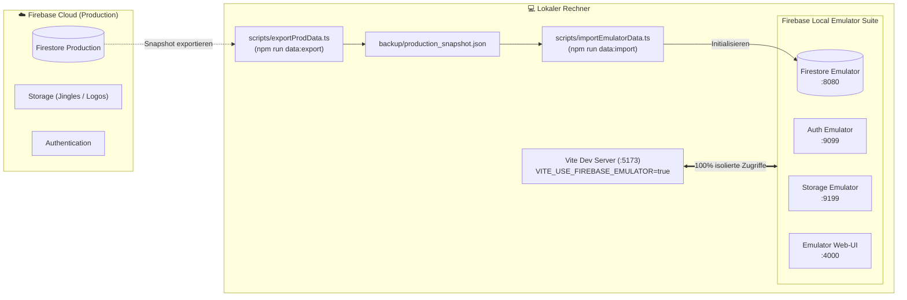

# 🧪 Lokale Testumgebung & Firebase Emulator Guide

Dieses Dokument beschreibt die Einrichtung, Nutzung und Daten-Synchronisation der lokalen Testumgebung für die **KBC Hallenhockey-Turnierverwaltung**.

---

## 🎯 Zweck & Überblick

Die App greift standardmäßig auf die produktive Firebase-Cloud-Instanz zu. Damit neue Features, Schiedsrichter-Eingaben, Zeitpläne oder Datenänderungen gefahrlos getestet werden können, existiert eine vollständig isolierte **Firebase Local Emulator Suite**:



### Die Kernvorteile:
* **Keine Gefahr für echte Daten**: Schreib- und Löschvorgänge im Leitstand oder Admin-Bereich wirken sich nur auf deinen Rechner aus.
* **Keine Cloud-Kosten & Quotas**: Beliebig viele Lese-/Schreiboperationen und Belastungstests ohne Google-Cloud-Kosten.
* **Offline-fähig & blitzschnell**: Lokale Datenbankabfragen ohne Netzwerklatenz.
* **Echtes Web-UI**: Volle Einsicht in Dokumente und Sammlungen über das Emulator-Dashboard (`http://localhost:4000`).

---

## 📋 Voraussetzungen

Die Firebase Emulator Suite benötigt eine lokale **Java-Laufzeitumgebung** (JRE ab Version 11):

### macOS (via Homebrew):
OpenJDK ist über Homebrew installiert (`/opt/homebrew/opt/openjdk`), Homebrew verlinkt Java auf dem Mac jedoch standardmäßig nicht global in `/usr/bin/java`.

Um Java systemweit für macOS und alle Terminals verfügbar zu machen, führe einmalig folgenden Befehl aus:
```bash
sudo ln -sfn /opt/homebrew/opt/openjdk/libexec/openjdk.jdk /Library/Java/JavaVirtualMachines/openjdk.jdk
```

*Alternativ ohne `sudo`*:
Füge OpenJDK zu deiner `~/.zshrc` hinzu:
```bash
echo 'export PATH="/opt/homebrew/opt/openjdk/bin:$PATH"' >> ~/.zshrc
source ~/.zshrc
```

*(Hinweis: Im npm-Skript `npm run emulators` ist der Pfad `/opt/homebrew/opt/openjdk/bin` bereits automatisch hinterlegt.)*

### Linux (Debian / Ubuntu):
```bash
sudo apt install default-jre
```

### Windows:
Lade [Adoptium Temurin OpenJDK](https://adoptium.net/) herunter und installiere es.

---

## 🚀 Der 4-Schritte-Workflow

### Schritt 1: Aktuelle Produktionsdaten exportieren
Liest die aktuellen Turnierdaten (`config`, `teams`, `matches`, `corners`, `players`, `auditLogs`) aus Firebase Production:

```bash
npm run data:export
```
Die Daten werden als saubere JSON-Datei unter `backup/production_snapshot.json` gespeichert.

---

### Schritt 2: Firebase Emulator starten
Öffne ein Terminal und starte die lokalen Emulatoren:

```bash
npm run emulators
```

Sobald der Emulator bereit ist, siehst du folgende Dienste:
* **Emulator Web-UI**: [http://localhost:4000](http://localhost:4000)
* **Firestore Emulator**: `localhost:8080`
* **Auth Emulator**: `localhost:9099`
* **Storage Emulator**: `localhost:9199`

> [!NOTE]
> Datenänderungen im Emulator werden beim Beenden (`Ctrl + C`) automatisch im Verzeichnis `backup/emulator_data` gesichert und beim nächsten Start wieder geladen.

---

### Schritt 3: Testdaten in den Emulator importieren
Öffne ein **zweites Terminal-Fenster** (während der Emulator läuft) und spiele den zuvor erstellten Snapshot ein:

```bash
npm run data:import
```

Nach wenigen Sekunden sind alle Teams, Spiele und Einstellungen in deinem lokalen Emulator verfügbar. Du kannst das direkt im Emulator-UI unter [http://localhost:4000/firestore](http://localhost:4000/firestore) überprüfen.

---

### Schritt 4: Web-App mit dem Emulator verbinden
Öffne deine `.env`-Datei und setze das Emulator-Flag auf `true`:

```env
VITE_USE_FIREBASE_EMULATOR=true
```

Starte nun wie gewohnt den Entwicklungsserver:

```bash
npm run dev
```

In der Browser-Entwicklerkonsole bestätigt dir die App die Verbindung:
```text
🛠️ [Firebase] Verbunden mit Firebase Emulatoren (127.0.0.1: Firestore 8080, Auth 9099, Storage 9199)
```

---

## 🔄 Zurück zur Produktion umschalten

Wenn du wieder mit der echten Produktions-Datenbank arbeiten möchtest:

1. Setze in deiner `.env`:
   ```env
   VITE_USE_FIREBASE_EMULATOR=false
   ```
2. Starte den Dev-Server neu (`npm run dev`).
3. *(Optional)* Den Emulator im anderen Terminal mit `Ctrl + C` stoppen.

---

## 🧹 Testdaten zurücksetzen

Falls du beim Testen Daten manipuliert hast und wieder den sauberen Ausgangszustand herstellen möchtest:

* **Möglichkeit A (Snapshot neu importieren)**:  
  Einfach erneut im zweiten Terminal ausführen:
  ```bash
  npm run data:import
  ```
* **Möglichkeit B (Vollständiger Reset ohne alte Historie)**:  
  Lösche den lokalen Persistenz-Ordner:
  ```bash
  rm -rf backup/emulator_data
  ```
  Und starte den Emulator anschließend neu.

---

## ❓ FAQ & Fehlerbehebung

### `Unable to locate a Java Runtime`
* **Ursache**: macOS findet Java nicht im Standardpfad, da Homebrew OpenJDK als „keg-only“ installiert.
* **Lösung**: Führe `sudo ln -sfn /opt/homebrew/opt/openjdk/libexec/openjdk.jdk /Library/Java/JavaVirtualMachines/openjdk.jdk` aus oder nutze direkt `npm run emulators`.

### `⚠ emulators: You are not currently authenticated...`
* **Bedeutung**: Das ist lediglich eine rein informative Warnung der Firebase CLI. Für den lokalen Emulator ist kein Google-/Firebase-Login notwendig. Wer die Meldung entfernen möchte, kann im Terminal einmalig `npx firebase login` aufrufen.

### `Port 8080 (oder 4000, 9099, 9199) is already in use`
* **Ursache**: Ein anderer Prozess blockiert den Port (z. B. eine alte Emulator-Instanz).
* **Lösung**: Finde den Prozess und beende ihn:
  ```bash
  lsof -i :8080
  kill -9 <PID>
  ```

### Was passiert mit Tor-Jingles und Team-Logos?
* Die Storage-Download-URLs der Teams und Jingles aus dem Production-Snapshot verweisen weiterhin auf die bestehenden Cloud-Storage-Dateien. Audio-Streams und Wappen funktionieren daher auch im lokalen Testbetrieb direkt weiter, ohne dass große Audio-Dateien synchronisiert werden müssen.
* Neue Uploads, die du im Emulator-Modus durchführst, landen sicher im lokalen Storage-Emulator (`localhost:9199`).

### Firebase Cloud Storage CORS einrichten (optional für Web Audio Limiter)
Falls die Web Audio API Pegel-Normalisierung auch für Remote-Dateien aus Firebase Storage ohne Fallback genutzt werden soll, kann CORS auf dem Bucket aktiviert werden:
```bash
# Mit Google Cloud CLI:
gcloud storage buckets update gs://kbc-turnier.firebasestorage.app --cors-file=cors.json

# Alternativ mit gsutil:
gsutil cors set cors.json gs://kbc-turnier.firebasestorage.app
```
*Hinweis*: Die App verfügt über einen automatischen Fallback auf natives HTML5 Audio, sodass alle Jingles auch ohne aktive CORS-Header auf dem Bucket immer zuverlässig abgespielt werden.
