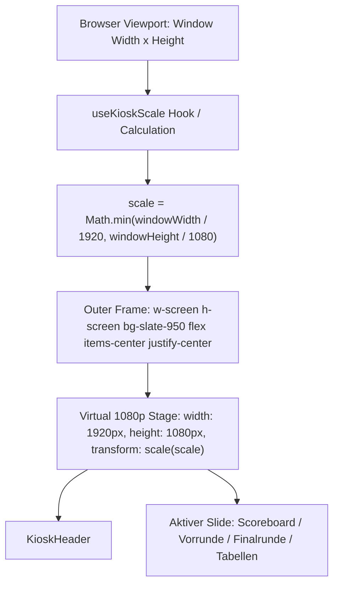

# SPEC-034: Kiosk Fit-to-Screen Skalierung (Virtual 1080p Stage)

> **Status**: In Abnahme  
> **Typ**: Feature / Optimierung  
> **Branch**: `feat/SPEC-034-kiosk-fit-to-screen-scaling`  
> **Autor**: Antigravity  
> **Erstellt am**: 2026-10-13  
> **Letzte Änderung**: 2026-10-13  
> **Betroffene Bereiche**: Kiosk (`/kiosk`)  

---

## 1. Übersicht & Zielsetzung

### 1.1 Problemstellung / Kontext
Die Kiosk-Ansicht (`/kiosk`) wurde in [SPEC-024](file:///Users/thorsten/Code/kbc-turnier/spec/SPEC-024-kiosk-seiten-redesign.md) für Großbildschirme und Hallen-Fernseher mit nativer Full-HD-Auflösung (1920x1080, 16:9) konzipiert und optimiert. Auf dem TV am Raspberry Pi sieht die Darstellung hervorragend und exakt abgestimmt aus.

Wird der Kiosk-Modus jedoch auf Geräten mit abweichenden Auflösungen oder Seitenverhältnissen geöffnet:
1. **MacBook Pro**: Selbst auf 14"- oder 16"-Displays beträgt die verfügbare Höhe im Browserfenster (abzüglich macOS-Menüleiste, Tab-Leiste, URL-Leiste und Dock) meist nur ca. 750 bis 880 px. Da die Folien auf 1080 px Höhe ausgelegt sind und vertikales Scrollen durch `overflow: hidden` verhindert wird, werden untere Elemente (wie die „Als Nächstes“-Leiste, Torschützen oder untere Zeilen der 12 Vorrundenspiele) abgeschnitten.
2. **iPad Air 11**: Im Querformat stehen lediglich 1180x820 px (effektiv oft nur ~720 px Höhe) zur Verfügung, zudem ist das Bildformat mit ca. 4,3:3 deutlich quadratischer als 16:9. Im Hochformat (820x1180 px) bricht das Tailwind-Grid zusammen und die Inhalte sind unvollständig.

Vorrangiges Ziel bleibt die perfekte, unberührte Darstellung auf dem 65"-TV. Gleichzeitig soll der Kiosk auf MacBooks und Tablets als zuverlässiger Kontroll- und Informationsmonitor nutzbar sein.

### 1.2 Zielzustand & Mehrwert
- **Virtual 1080p Stage**: Die Kiosk-Bühne behält intern eine feste, verlässliche Arbeitsfläche von exakt **$1920 \times 1080$\,px** (Full-HD, 16:9).
- **Proportionale Fit-to-Screen-Skalierung**: Über eine performante CSS-Transform-Skalierung (`scale(S)`) passt sich die 1080p-Bühne dynamisch an jedes beliebige Browser- und Bildschirmfenster an:
  $$\text{Scale } S = \min\left(\frac{\text{Viewport-Breite}}{1920}, \frac{\text{Viewport-Höhe}}{1080}\right)$$
- **0,00 % Auswirkung auf den TV**: Bei 1920x1080 (Vollbild auf Raspberry Pi / Full-HD-TV) ist der Skalierungsfaktor exakt $S = 1{,}00$. Die Darstellung auf dem TV bleibt zu 100 % pixel- und layoutidentisch.
- **Perfektes Bild auf MacBook & iPad**: Auf kleineren oder abweichenden Bildschirmen wird der Kiosk ohne jegliche Verzerrung zentriert auf die Maximalgröße skaliert, sodass garantiert alle Inhalte, Badges, Tabellen und Torschützen vollständig sichtbar sind (Letterboxing mit dezentem, dunklem Hintergrund).
- **Entfall des Beenden-Buttons**: Der Beenden-Button in der oberen Ecke wird vollständig entfernt, um störende Overlays auf den Letterbox-Rändern (z. B. am iPad) zu vermeiden; Verlassen erfolgt direkt über URL / Browser.
- **Offline-Banner**: Bleibt bei Verbindungsausfall sichtbar.

---

## 2. User Stories

- **US-1 (Turnierleiter am MacBook Pro)**: Als Turnierleiter möchte ich die Kiosk-Ansicht auf meinem MacBook im Browserfenster öffnen können, um genau das zu sehen, was die Zuschauer auf dem TV sehen – vollständig, ohne abgeschnittene Ränder oder fehlende Fußleisten.
- **US-2 (Helfer / Zuschauer am iPad Air)**: Als Helfer in der Halle möchte ich den Kiosk auf einem iPad Air im Querformat als Informationsmonitor aufstellen können, wobei alle Spiele und Tabellen ohne Scrollen harmonisch und vollständig lesbar sind und keine störenden UI-Buttons über dem Letterbox-Rand liegen.
- **US-3 (Zuschauer vor dem TV)**: Als Zuschauer in der Halle erwarte ich auf dem 65"-TV am Raspberry Pi ein gestochen scharfes, unverändertes Full-HD-Bild ohne Layout-Brüche oder Artefakte.

---

## 3. Fachliche Anforderungen & Scope

### 3.1 Im Scope (Must-Have)
- [x] **Kiosk Stage Scaler**:
  - Container-Komponente oder Wrapper in `KioskLayout.tsx`, der die Viewport-Maße (`window.innerWidth`, `window.innerHeight`) per Event-Listener (`resize`, `orientationchange`) überwacht.
  - Exakte innere Leinwand: `width: 1920px`, `height: 1080px`, `overflow: hidden`.
  - Zentrierte CSS-Skalierung mit `transform: scale(S)` und `transform-origin: center center`.
  - Wenn `width >= 1920 && height >= 1080` (TV im Vollbild): Skalierung ist genau `1.0` (keine optischen Veränderungen).
  - Wenn `width < 1920` oder `height < 1080`: Proportionale Skalierung `Math.min(w / 1920, h / 1080)`.
- [x] **Letterbox & Hintergrund**:
  - Zentrierte Ausrichtung im Viewport.
  - Äußerer Container mit dezentem dunklem Hintergrund (`bg-slate-950` oder `bg-slate-900`), der sich wie ein hochwertiger TV-Rahmen anfühlt.
- [x] **Entfernung Beenden-Button**:
  - Der bisherige Overlay-Button „Beenden“ wird komplett entfernt, da das Verlassen über URL/Browser-Navigation erfolgt.
- [x] **Interaktivität & Vollbild**:
  - Alle Bedienelemente im `KioskHeader` (Folien-Umschaltung, Pause/Play, Vollbild-Button) bleiben voll interaktiv (CSS-Scale erhält Pointer-Events nativ auf allen Plattformen).

### 3.2 Explizit Out-of-Scope
- Keine inhaltlichen Änderungen an den 4 Folien (`KioskScoreboardSlide`, `KioskGroupStageSlide`, `KioskFinalsSlide`, `KioskStandingsSlide`).
- Keine Änderungen an der Gast- (`/`) oder Admin-Ansicht (`/admin`).
- Keine Änderungen an Firestore-Datenstrukturen oder Backend-Services.

---

## 4. Akzeptanzkriterien

### 4.1 Szenarien / Kriterien
- [x] **AC-1: Pixel-identische Darstellung auf 1920x1080 (TV)**
  - **Gegeben sei**: Ein Display mit nativer 1920x1080-Auflösung im Vollbildmodus.
  - **Wenn**: `/kiosk` aufgerufen wird.
  - **Dann**:
    1. Beträgt der Skalierungsfaktor exakt `1.0`.
    2. Füllt die 1080p-Leinwand das Display nahtlos aus.
    3. Es gibt keinerlei visuelle Abweichung gegenüber dem bisherigen TV-Stand.
- [x] **AC-2: Vollständige Sichtbarkeit auf MacBook Pro (Höhe < 1080px)**
  - **Gegeben sei**: Ein MacBook Pro mit z. B. 1440x850 px oder 1512x900 px Browser-Viewport.
  - **Wenn**: `/kiosk` betrachtet wird (alle 4 Folien: Live, Vorrunde, Finalrunde, Tabellen).
  - **Dann**:
    1. Wird der Inhalt proportional verkleinert, sodass er vollständig in die Höhe passt.
    2. Es wird kein Element abgeschnitten (insbesondere „Als Nächstes“-Balken, Torschützen, Zeile 12 der Vorrunde und Zeile 4 der Tabellen sind voll sichtbar).
    3. Es existieren keine vertikalen Scrollbalken.
- [x] **AC-3: Saubere Skalierung auf iPad Air 11 (Querformat)**
  - **Gegeben sei**: Ein iPad Air mit 1180x820 px im Querformat.
  - **Wenn**: `/kiosk` geladen wird.
  - **Dann**:
    1. Passt sich die gesamte 1080p-Bühne proportional ein.
    2. Sämtliche Texte und Tabellen bleiben scharf und zentriert lesbar.
    3. Die Slide-Navigation im Header lässt sich per Touch bedienen.
- [x] **AC-4: Reaktives Verhalten bei Fenster-Resize**
  - **Gegeben sei**: Der Kiosk läuft in einem Desktop-Fenster.
  - **Wenn**: Die Fenstergröße verändert wird.
  - **Dann**: Passt sich der Skalierungsfaktor flüssig und ohne Layout-Verschiebungen in Echtzeit an.

### 4.2 Allgemeine Qualitätskriterien
- [x] Keine fest kodierten Turnierparameter (gemäß `AGENTS.md`).
- [x] Vollständige TypeScript-Typisierung ohne `any`.
- [x] Fehlerfreier Build (`npm run build`) und sauberes Linting.
- [x] Sauberes Aufräumen des Window-Resize-Listeners im `useEffect`.

---

## 5. UI/UX & Interaktionskonzept

### 5.1 Betroffene Komponenten
- `src/components/layouts/KioskLayout.tsx`:
  - Einbettung des Skalierungs-Containers für den `<Outlet />`-Bereich.
  - Bereitstellung des Letterbox-Rahmens.
- `src/pages/kiosk/KioskPage.tsx`:
  - Definition der festen Dimension `w-[1920px] h-[1080px]` für den Haupt-Inhaltsbereich.

### 5.2 Skalierungs-Architektur

---

## 6. Technische Auswirkungen & Architekturbezug

### 6.1 Datenmodell
Keine Änderungen an Firestore-Daten oder Modellen.

### 6.2 Performance & Rendering
- `transform: scale()` nutzt GPU-Beschleunigung und erzeugt keinen wiederholten Reflow des internen DOMs.
- Auf Retina-Displays (MacBook, iPad) rendert WebKit durch Subpixel-Sampling die herunterskalierte 1080p-Bühne extrem scharf.

---

## 7. Edge Cases & Fehlerbehandlung

- **Extrem schmale Viewports (z. B. Smartphone Portrait)**: Auch hier skaliert die Bühne mathematisch korrekt herunter (wie eine Miniatur-Vorschau), ohne das Layout zu brechen.
- **Browser-Zoom (Strg/Cmd + Plus/Minus)**: Ändert `window.innerWidth/innerHeight`, der Skalierungs-Hook reagiert sofort und hält die Bühne eingepasst.
- **Orientation Change**: Event `orientationchange` und `resize` stellen sicher, dass Drehungen auf dem iPad unverzüglich neu berechnet werden.

---

## 8. Verifikations- & Testplan

### 8.1 Manuelle Tests
1. [ ] Aufruf auf Desktop mit 1920x1080 (Vollbild): Skalierung ist 1:1, identisch mit dem Produktivstand.
2. [ ] Test im verkleinerten Browserfenster (MacBook-Größe ~1400x800): Alle 4 Slides prüfen, ob Torschützen, untere Spielpaarungen und Tabellen vollständig sichtbar sind.
3. [ ] Test im Safari Responsive Mode (iPad Air Querformat 1180x820): Skalierung und Touchbedienung der Header-Buttons prüfen.
4. [ ] Umschalten der Slides (Auto-Rotation & manuelle Buttons): Funktioniert reibungslos.
5. [ ] Beenden-Button klicken: Navigiert sicher zurück zu `/`.

### 8.2 Automatisierte Validierung
- [ ] `npm run lint` fehlerfrei.
- [ ] `npm run build` fehlerfrei.
