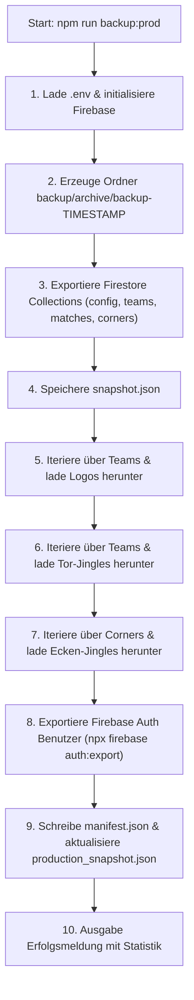

# SPEC-064: Vollständiges Online-Backup mit Zeitstempel & Mediendateien (Teams, Kader, Spielplan, Jingles, Logos, Admins)

> **Status**: Abgeschlossen  
> **Typ**: Feature / Tooling  
> **Branch**: `feat/SPEC-064-vollstaendiges-online-backup`  
> **Autor**: Antigravity  
> **Erstellt am**: 2026-10-23  
> **Letzte Änderung**: 2026-10-23  
> **Betroffene Bereiche**: Datenbank/Firestore | Audio/Storage | Tooling/CLI  

---

## 1. Übersicht & Zielsetzung

### 1.1 Problemstellung / Kontext
Bisher existiert lediglich das Skript `npm run data:export` (`scripts/exportProdData.ts`). Dieses exportiert zwar die Firestore-Dokumente (`config`, `teams`, `matches`, `corners`, `auditLogs`) in eine einzige Datei `backup/production_snapshot.json`, weist jedoch wesentliche Lücken auf:
1. **Kein Medien-Download**: Vereinslogos (`logoUrl`), Tor-Jingles (`jingleUrl`) und neutrale Ecken-Jingles (`audioUrl`) werden nur als URL-Strings exportiert. Die eigentlichen Binärdateien im Firebase Storage werden nicht gesichert. Bei einem Ausfall oder Datenverlust wären hochgeladene Medien verloren.
2. **Keine Firebase-Auth-Benutzer**: Benutzerkonten (Admins) befinden sich in Firebase Authentication und werden vom bestehenden Skript nicht gesichert.
3. **Überschreiben statt Archivieren**: `data:export` überschreibt jedes Mal dieselbe Datei `production_snapshot.json`. Es gibt keine zeitstempelbasierte Historie oder Revisionssicherheit vor dem Turnierstart.

### 1.2 Zielzustand & Mehrwert
- Ein eigenständiger CLI-Befehl `npm run backup:prod` (bzw. `npm run backup`), der ein vollständiges, autarkes Offline-Backup aller Online-Daten des Turniers zieht.
- Jedes Backup wird in einem eigenen Unterordner mit exaktem Zeitstempel archiviert (z. B. `backup/archive/backup-2026-10-23_16-45-00/`).
- Alle aktiven Mediendateien (Team-Logos, Tor-Jingles, Ecken-Jingles) werden physisch aus Firebase Storage heruntergeladen und lokal strukturiert abgelegt.
- Firebase Auth Benutzerkonten (Admins) werden automatisiert via Firebase CLI exportiert (mit sauberem Fallback/Hinweis, falls CLI-Login fehlt).
- Zur Kompatibilität mit dem bestehenden Emulator-Import (`npm run data:import`) wird parallel die zentrale `backup/production_snapshot.json` aktualisiert.

---

## 2. User Stories

- **US-1**: Als **Turnierleiter / Administrator** möchte ich mit einem einzigen Terminal-Befehl ein vollständiges Backup des gesamten Turniersystems (Teams, Kader, Spielplan, Jingles, Logos, Admins) erzeugen können, um vor Turnierbeginn oder vor großen Änderungen eine verlässliche Rückfallebene zu haben.
- **US-2**: Als **Administrator** möchte ich, dass jedes Backup in einem Ordner mit Datums- und Zeitstempel abgelegt wird, um mehrere Sicherungsstände parallel vorzuhalten und nicht versehentlich ältere Backups zu überschreiben.
- **US-3**: Als **Turnierleitung** möchte ich sicherstellen, dass auch alle hochgeladenen Tor-Jingles und Team-Logos physisch auf der Festplatte liegen, damit der Hallen-Livebetrieb selbst bei einem Cloud-Storage-Problem oder Internetausfall gesichert ist.
- **US-4**: Als **Entwickler** möchte ich im Terminal eine klare Übersicht sehen, wie viele Dokumente, Mediendateien und Konten gesichert wurden und wo diese zu finden sind.

---

## 3. Fachliche Anforderungen & Scope

### 3.1 Im Scope (Must-Have)

- [x] **Neuer Script-Befehl in `package.json`**:
  - `npm run backup:prod`: Führt das neue Skript `tsx scripts/backupProdData.ts` aus.
  - Optionaler Alias `npm run backup`.
- [x] **Zeitstempel-Ordnerstruktur**:
  - Jede Ausführung erzeugt ein Verzeichnis `backup/archive/backup-YYYY-MM-DD_HH-mm-ss/`.
- [x] **Vollständiger Firestore-Export**:
  - `config` (`tournament`, `info`)
  - `teams` (Stammdaten, Kontaktpersonen, `players`-Kader, `jingleToken`, `linkGenerationCount`, etc.)
  - `matches` (Spielplan mit allen 40 Partien, Schiedsrichtern, Toren, Ereignissen)
  - `corners` (Ecken-Jingles Konfiguration)
  - `auditLogs` (falls vorhanden)
  - Ablage als formatierte `snapshot.json` im Backup-Ordner.
- [x] **Physischer Download aller Mediendateien**:
  - Team-Logos (`storage/teams/{teamId}/logo.<ext>`)
  - Team Tor-Jingles (`storage/teams/{teamId}/jingle.<ext>`)
  - Ecken-Jingles (`storage/corners/{cornerId}.<ext>`)
  - Erkennung der Dateiendung anhand des URLs bzw. des `content-type`-Headers beim Download.
  - Robuste Fehlerbehandlung: Ein einzelner fehlschlagender Download bricht nicht das gesamte Backup ab, sondern wird geloggt.
- [x] **Sicherung der Admin-Benutzer (Firebase Authentication)**:
  - Automatischer Versuch, `npx firebase auth:export` in den Unterordner `auth/accounts.json` auszuführen.
  - Falls Firebase CLI nicht authentifiziert ist: Erstellung von `auth/README.txt` mit einer exakten Schritt-für-Schritt-Anleitung, wie der Auth-Export mit einem Befehl durchgeführt werden kann.
- [x] **Metadaten-Manifest**:
  - Im Backup wird eine `manifest.json` mit Datum, Projekt-ID, Anzahl der gesicherten Dokumente, Mediendateien und Fehlerprotokollen gespeichert.
- [x] **Rückwärtskompatibilität**:
  - Der Snapshot wird zusätzlich nach `backup/production_snapshot.json` geschrieben, damit der bestehende Befehl `npm run data:import` für den Firebase-Emulator weiterhin wie gewohnt funktioniert.

### 3.2 Explizit Out-of-Scope

- Automatischer zeitgesteuerter Cron-Daemon auf dem Server (das Skript wird bei Bedarf manuell vom Betreiber vor dem Turnier gestartet).
- Automatischer Re-Upload aller lokalen Mediendateien in den Firebase Cloud Storage (dies ist ein reines Backup- und Archivierungswerkzeug).

---

## 4. Akzeptanzkriterien

### 4.1 Szenarien / Kriterien

- [x] **AC-1: Aufruf des Backup-Skripts**
  - **Gegeben sei**: Eine konfigurierte `.env`-Datei mit gültigen Firebase-Keys.
  - **Wenn**: Im Terminal `npm run backup:prod` ausgeführt wird.
  - **Dann**: Startet der Prozess, verbindet sich mit Firebase und legt unter `backup/archive/backup-YYYY-MM-DD_HH-mm-ss/` einen neuen Ordner an.

- [x] **AC-2: Firestore-Daten vollständig gesichert**
  - **Gegeben sei**: Teams mit Spielkader, Spielplan und Konfiguration in der Cloud-Datenbank.
  - **Wenn**: Das Backup durchläuft.
  - **Dann**: Enthält `snapshot.json` im Backup-Verzeichnis alle Collections (`config`, `teams`, `matches`, `corners`, `auditLogs`), inklusive aller Spielkader-Einträge und Team-Link-Tokens.

- [x] **AC-3: Physischer Download von Logos und Jingles**
  - **Gegeben sei**: Teams und Ecken-Jingles mit hinterlegten URLs.
  - **Wenn**: Das Backup ausgeführt wird.
  - **Dann**: Werden alle referenzierten Bild- und Audiodateien in `storage/teams/{teamId}/...` bzw. `storage/corners/...` physisch gespeichert und sind lokal mit einem Media-Player / Bildbetrachter abspielbar/öffenbar.

- [x] **AC-4: Auth-Benutzer Handling**
  - **Gegeben sei**: Das Backup-Skript läuft.
  - **Wenn**: Firebase CLI angemeldet ist, wird `auth/accounts.json` erzeugt.
  - **Dann**: Falls die CLI nicht angemeldet ist, bricht das Skript nicht ab, sondern legt `auth/README.txt` mit klaren Hinweisen an und quittiert dies mit einer gelben Statusmeldung.

- [x] **AC-5: Terminal-Zusammenfassung & Statusbericht**
  - **Gegeben sei**: Das Skript hat alle Schritte ausgeführt.
  - **Wenn**: Der Prozess endet.
  - **Dann**: Zeigt das Terminal eine formatierte Zusammenfassung (Anzahl Dokumente, Teams, Matches, heruntergeladene Logos, heruntergeladene Jingles, Speicherpfad und Zeitbedarf).

### 4.2 Allgemeine Qualitätskriterien

- [x] Keine hardcodierten Pfade oder Anmeldedaten im Quellcode (`AGENTS.md`).
- [x] Strikte TypeScript-Typisierung ohne `any`.
- [x] `npm run build` und `npm run lint` laufen ohne Warnungen oder Fehler durch.

---

## 5. Technische Architektur & Ordnerstruktur

### 5.1 Ordnerstruktur eines Backups

```
backup/
├── archive/
│   └── backup-2026-10-23_16-45-12/
│       ├── manifest.json                  # Zusammenfassung, Zähler, Dauer, Version
│       ├── snapshot.json                  # Vollständiger Firestore-JSON-Export
│       ├── storage/
│       │   ├── teams/
│       │   │   ├── team-mu14-1/
│       │   │   │   ├── logo.webp          # Logo des Teams
│       │   │   │   └── jingle.mp3         # Tor-Jingle des Teams
│       │   │   └── ...
│       │   └── corners/
│       │       ├── corner-1.mp3           # Neutraler Ecken-Jingle
│       │       └── ...
│       └── auth/
│           ├── accounts.json              # Firebase Auth Export (falls CLI auth)
│           └── README.txt                 # Anleitung & Status zu Auth
├── production_snapshot.json               # Immer aktuellster Stand für 'data:import'
└── emulator_data/                         # Emulator-Persistenzdaten
```

### 5.2 Ablauf im Skript `scripts/backupProdData.ts`



---

## 6. Verifikations- & Testplan

### 6.1 Manuelle Tests
1. [x] Aufruf von `npm run backup:prod` im Terminal.
2. [x] Prüfung des neu erstellten Ordners `backup/archive/backup-...`.
3. [x] Kontrolle der `snapshot.json`: Sind alle 16 Teams, alle Kader (`players`), alle 40 Matches und die Ecken-Jingles enthalten?
4. [x] Kontrolle des `storage/`-Verzeichnisses: Sind die Logos und Audio-Dateien vorhanden und funktionstüchtig abspielbar?
5. [x] Kontrolle des `auth/`-Ordners: accounts.json erfolgreich angelegt.
6. [x] Prüfung, ob `npm run data:import` weiterhin funktioniert.

### 6.2 Automatisierte Validierung
- [x] `npm run lint` fehlerfrei.
- [x] `npm run build` fehlerfrei.

---

## 7. Offene Fragen & Klärungsbedarf
- Keine. Alle Anforderungen wurden mit dem Nutzer vorab abgestimmt.
